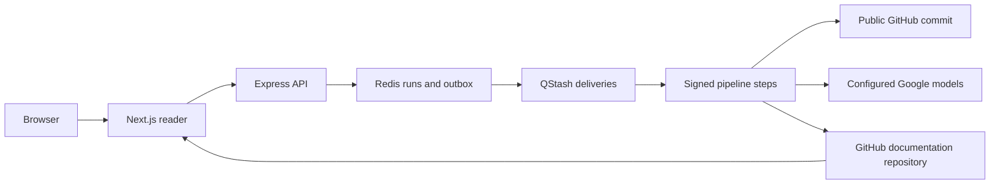

# GitDex

Turn a public GitHub repository into a source-linked guide, then ask questions against its actual code.

Production: https://gitdex-alpha.vercel.app

## What it does

- Scans one immutable source commit, plans a guide, generates sections, and publishes the complete guide together.
- Renders non-executable Markdown with code highlighting, tables, mathematics, and validated Mermaid diagrams.
- Searches within the current repository’s published guide.
- Answers repository questions with bounded source-reading tools and links to the pinned commit.
- Keeps the previous guide readable while a refresh is queued, running, or failed.
- Uses the same green identity across the landing page, reader, status screens, assistant, and app icons. Dark is the first-visit default; the footer theme control remembers a light/dark choice.

## Architecture

`client/` is the Next.js/Fumadocs reader and assistant interface. `server/` is the Express API, source reader, generator, and durable Redis/QStash pipeline.

Indexing phases are scan, plan, sections, and publish. Immutable run IDs and token-owned leases reject stale worker completions. Redis Lua atomically admits work, records the next delivery, and promotes the next repository. A signed recurring reconciler retries durable delivery intents; QStash delivers steps at least once.

Publication uses one Git tree/commit and a non-force branch update. Invalid output does not replace the last published guide. Redis ownership and a GitHub ref update are not a cross-service transaction; an already-sent GitHub write cannot be revoked by losing a lease.

## Reading limits

Indexing selects up to 50 eligible files and plans up to 20 sections by default. A guide’s manifest records its source commit, selected files, coverage, generator version, and section dependencies. The reader discloses available provenance; an older guide without a manifest is not presented as fully audited source coverage.

The assistant reads public source independently of the generated guide. It has bounded file/search budgets and a request deadline. Its answers are generated, not a substitute for reviewing the cited source. Private repositories are not supported, and the documentation writer token is never used to read source repositories.

## Development and deployment

- [Client setup and reader behavior](client/README.md)
- [API, queue, configuration, and deployment](server/README.md)

Install each package with Bun. Verify both packages with `bun x tsc --noEmit`; build the client with `bun run build`. Development servers belong in separate windows of the `omp` tmux session.

CLI deployments can include uncommitted local changes. Indexing still reads the source commit published on GitHub, not the local working tree. Do not delete published guides or shared Redis keys to force a fresh run.
